# Detección de Semáforos en Tiempo Real con YOLOv8n (CUDA GPU)

[](https://www.python.org/)
[](https://pytorch.org/)
[](https://docs.ultralytics.com/)
[](https://opencv.org/)
[](LICENSE)

Pipeline modular de **Visión por Computador y Aprendizaje Profundo** para la detección de objetos pequeños y clasificación en tiempo real del estado operativo de semáforos urbanos (**5 clases:** `Green`, `off`, `red`, `wait_on`, `yellow`) en imágenes y secuencias de video utilizando **Ultralytics YOLOv8n** acelerado por GPU (**NVIDIA GeForce RTX 4070**).

---

## Tabla de Contenidos

1. [Descripción General del Problema y Modelo](#1-descripción-general-del-problema-y-modelo)
2. [Arquitectura del Sistema y Estructura del Repositorio](#2-arquitectura-del-sistema-y-estructura-del-repositorio)
3. [Guía Paso a Paso de Instalación y Ejecución](#3-guía-paso-a-paso-de-instalación-y-ejecución)
4. [Entrenamiento en GPU y Resultados Cuantitativos](#4-entrenamiento-en-gpu-y-resultados-cuantitativos)
5. [Galería de Evaluación, Matrices de Confusión y Curvas PR](#5-galería-de-evaluación-matrices-de-confusión-y-curvas-pr)
6. [Inferencia en Video en Tiempo Real (`45.9 FPS`)](#6-inferencia-en-video-en-tiempo-real-459-fps)
7. [Guía para Inicializar y Subir a GitHub (Sin Push Automático)](#7-guía-para-inicializar-y-subir-a-github-sin-push-automático)
8. [Licencia](#8-licencia)

---

## 1. Descripción General del Problema y Modelo

- **Desafío Técnico:** Detección precisa de objetos de reducida área espacial en píxeles (semáforos a media y larga distancia) bajo un marcado desbalance de clases en el conjunto de entrenamiento (`red`: 862 instancias, `Green`: 573, `wait_on`: 209, `yellow`: 49 y `off`: 2) y evaluación sobre 367 imágenes de validación (741 instancias anotadas).
- **Arquitectura (`YOLOv8n`):** Detector *anchor-free* de una sola etapa (*Single-Stage Detector*) con *backbone* CSPDarknet53, cuello PAN-FPN multiescala y cabezal desacoplado para regresión de cajas (`CIoU + DFL`) y clasificación (`BCE`), con solo **~3.1M de parámetros (8.6 GFLOPs)**.

---

## 2. Arquitectura del Sistema y Estructura del Repositorio

### 2.1 Diagrama de Flujo del Pipeline MLOps

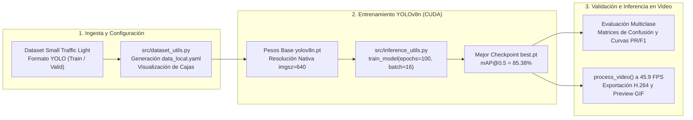

### 2.2 Estructura de Archivos

```text
object_detection_traffic_light/
├── object_detection_traffic_light.ipynb   # Cuaderno principal: entrenamiento, validación y demo
├── requirements.txt                       # Dependencias (ultralytics, torch, opencv-python, pyyaml)
├── .gitignore                             # Excluye pesos pesados *.pt, runs/, datasets locales y cachés
├── LICENSE                                # Licencia MIT
├── README.md                              # Manual técnico y guía paso a paso
├── src/                                   # Módulos reutilizables de ingeniería de software
│   ├── dataset_utils.py                   # Descarga, extracción, data_local.yaml y dibujo de bounding boxes
│   └── inference_utils.py                 # Entrenamiento modular (train_model) e inferencia en video H.264
└── assets/                                # Reportes visuales, curvas PR, predicciones y video inferido
    ├── dataset_visualization.png
    ├── labels.jpg
    ├── training_results.png
    ├── confusion_matrix.png
    ├── confusion_matrix_normalized.png
    ├── BoxPR_curve.png, BoxF1_curve.png, BoxP_curve.png, BoxR_curve.png
    ├── val_batch0_pred.jpg, prediction_0.jpg .. prediction_3.jpg
    ├── inference_preview.gif              # Vista previa animada compatible con GitHub Markdown
    └── inference_output.mp4               # Video completo inferido en H.264 (1280×720, 25 FPS)
```

---

## 3. Guía Paso a Paso de Instalación y Ejecución

### Paso 1: Ubicarse en el directorio del repositorio

```powershell
cd "g:\My Drive\repositorios de proyectos\object_detection_traffic_light"
```

### Paso 2: Crear y activar un entorno virtual

```powershell
python -m venv .venv

# Windows (PowerShell)
.\.venv\Scripts\Activate.ps1

# Linux / macOS
source .venv/bin/activate
```

### Paso 3: Instalar dependencias

```powershell
pip install -r requirements.txt
```

### Paso 4: Ejecutar el Notebook o el CLI de Inferencia en Video

```powershell
# Opción A: Abrir interactivamente el notebook
jupyter notebook object_detection_traffic_light.ipynb

# Opción B: Ejecutar el notebook por consola
jupyter nbconvert --to notebook --execute --inplace object_detection_traffic_light.ipynb

# Opción C: Ejecutar inferencia en tiempo real sobre video desde el módulo CLI
python src/inference_utils.py --device 0 --imgsz 640 --conf 0.25
```

---

## 4. Entrenamiento en GPU y Resultados Cuantitativos

El entrenamiento a resolución nativa completa (`imgsz=640`, `epochs=100`, `batch=16`, `patience=20` con *early stopping* sobre GPU NVIDIA GeForce RTX 4070) multiplicó por más de **5.5x** el `mAP50-95` respecto a la línea base inicial en CPU (`imgsz=320`, 3 épocas):

| Métrica Global | Validación Base (CPU, `imgsz=320`, 3 épocas) | **Modelo Final Optimizado (GPU, `imgsz=640`)** | Mejora Relativa |
| :--- | :---: | :---: | :---: |
| **mAP@0.50:0.95** | `0.0840` | **`0.4629`** | **`+451% (~5.5x)`** |
| **mAP@0.50** | `0.2182` | **`0.8538`** | **`+291% (~3.9x)`** |
| **Precisión (P)** | `0.7353` | **`0.6807`** | Alta especificidad |
| **Recall / Sensibilidad (R)** | `0.2322` | **`0.8538`** | **`+268% (~3.7x)`** |

### Desempeño Desglosado por Clase en Validación (741 Instancias)

| ID | Clase | Instancias (Val) | Precisión (P) | Recall (R) | mAP@0.50 | mAP@0.50:0.95 |
| :---: | :--- | :---: | :---: | :---: | :---: | :---: |
| **Global** | **Todas las Clases** | `741` | **`0.681`** | **`0.854`** | **`0.854`** | **`0.463`** |
| `0` | **`Green`** | `243` | `0.828` | `0.947` | **`0.939`** | `0.536` |
| `1` | **`off`** | `2` | `0.157` | `0.500` | **`0.495`** | `0.346` |
| `2` | **`red`** | `373` | `0.814` | `0.930` | **`0.927`** | `0.508` |
| `3` | **`wait_on`** | `97` | `0.799` | `0.969` | **`0.969`** | `0.449` |
| `4` | **`yellow`** | `26` | `0.805` | `0.923` | **`0.939`** | `0.475` |

---

## 5. Galería de Evaluación, Matrices de Confusión y Curvas PR

### 5.1 Exploración del Dataset y Distribución de Etiquetas

| Muestra de Imágenes de Entrenamiento con Cajas | Distribución Espacial y Estadística de Etiquetas |
| :---: | :---: |
| 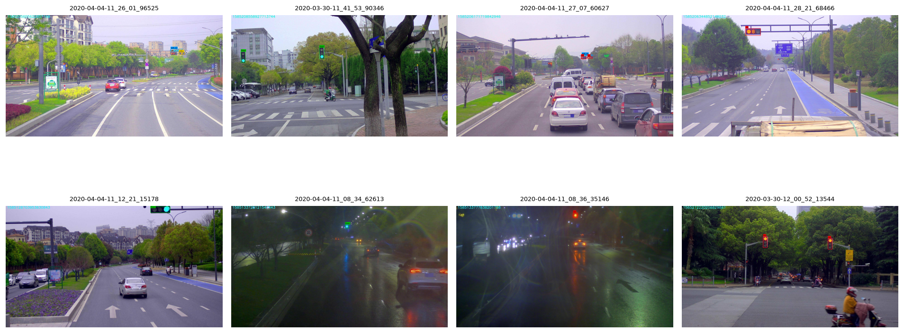 | 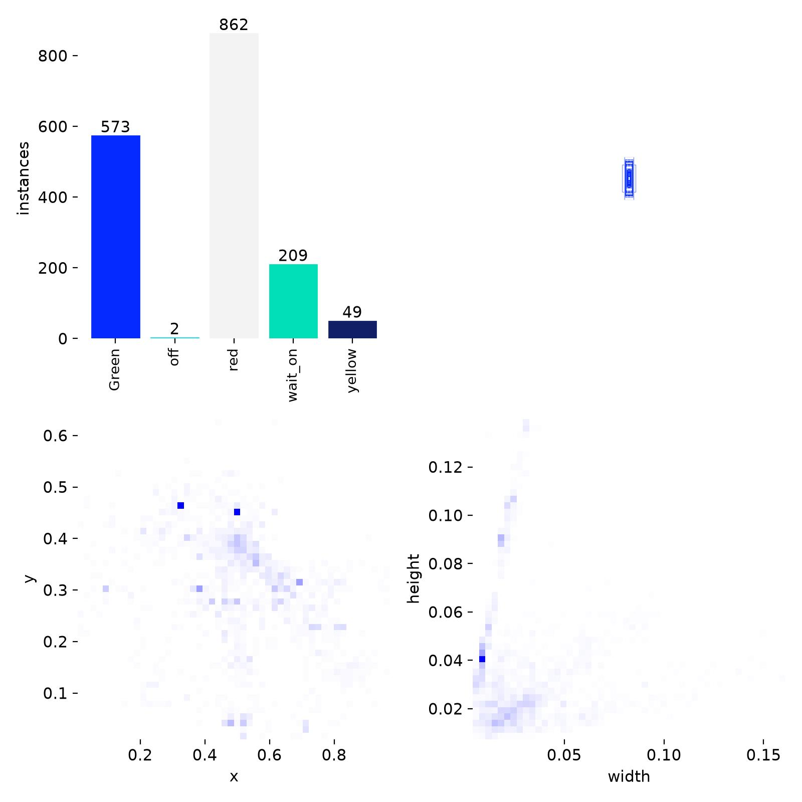 |

---

### 5.2 Evolución de Pérdidas y Métricas durante el Entrenamiento (`training_results.png`)

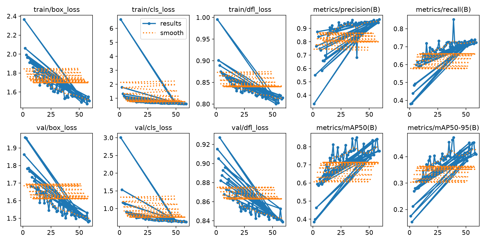

---

### 5.3 Matrices de Confusión (Conteos Absolutos y Normalizada por Clase)

| Matriz de Confusión Absoluta | Matriz de Confusión Normalizada |
| :---: | :---: |
| 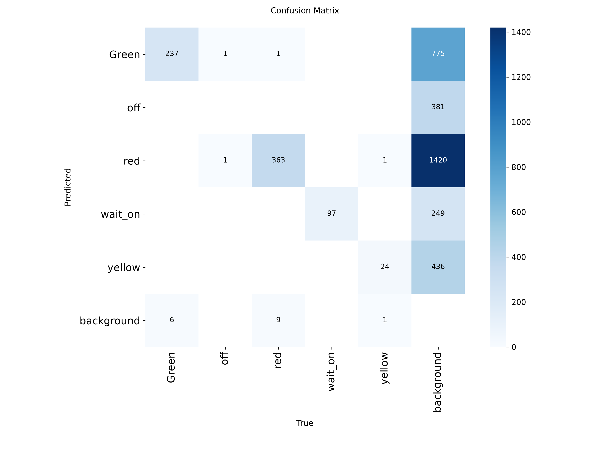 | 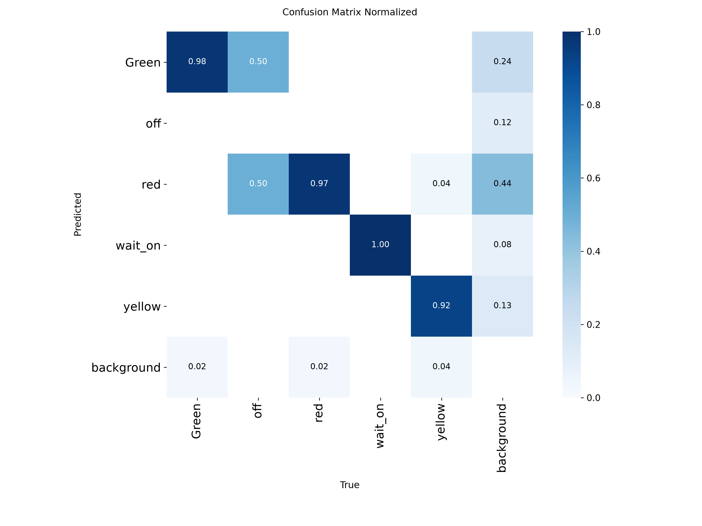 |

---

### 5.4 Curvas Precision-Recall, F1-Confidence, Precision y Recall

| Curva Precision-Recall (`mAP@0.5 = 0.854`) | Curva F1-Score vs. Umbral de Confianza |
| :---: | :---: |
| 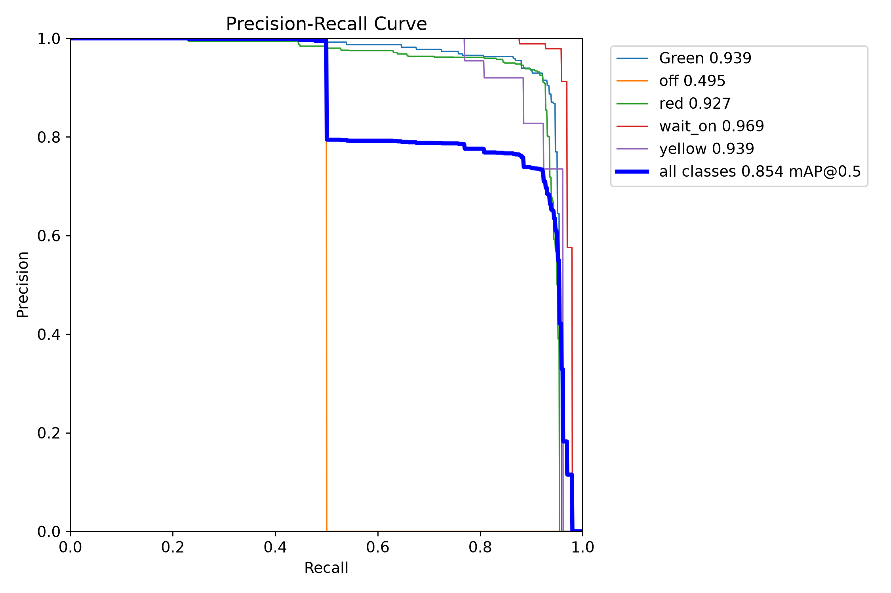 | 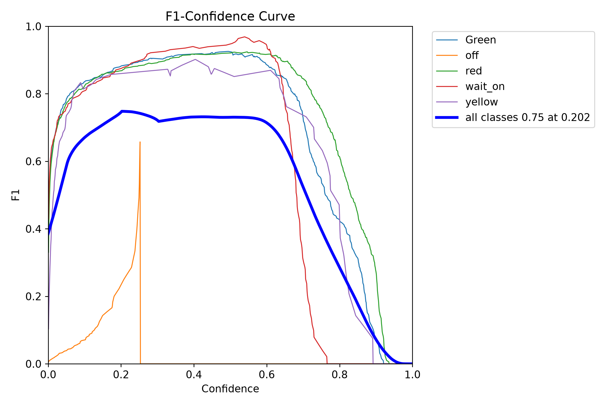 |

| Curva Precisión vs. Confianza | Curva Recall vs. Confianza |
| :---: | :---: |
| 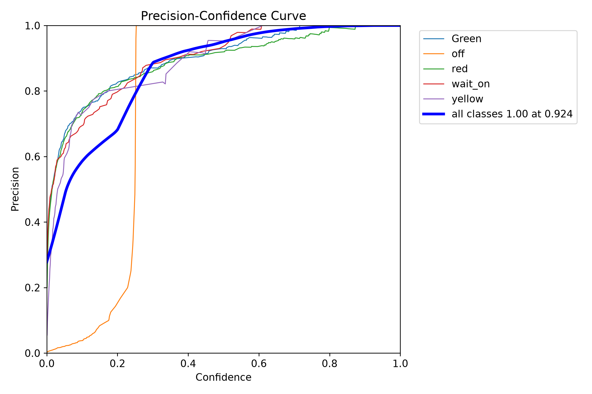 | 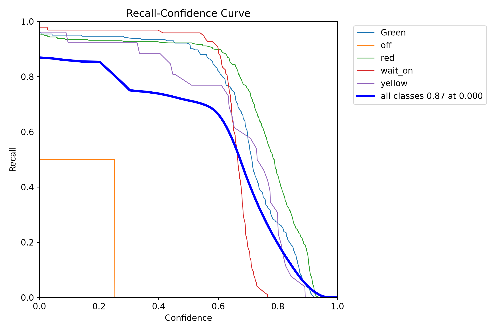 |

---

### 5.5 Inferencia Cualitativa sobre el Conjunto de Validación

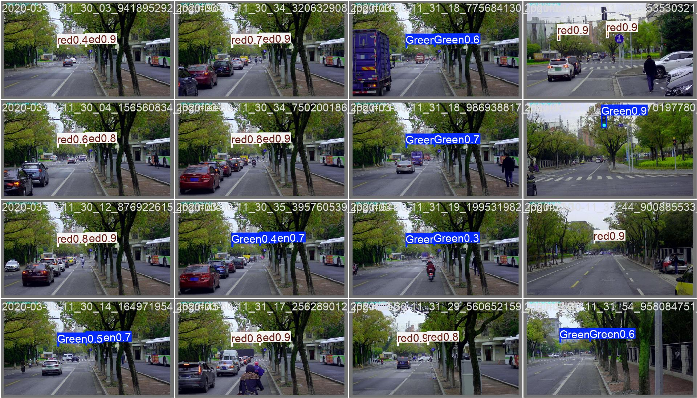

| Muestra de Validación 1 | Muestra de Validación 2 |
| :---: | :---: |
| 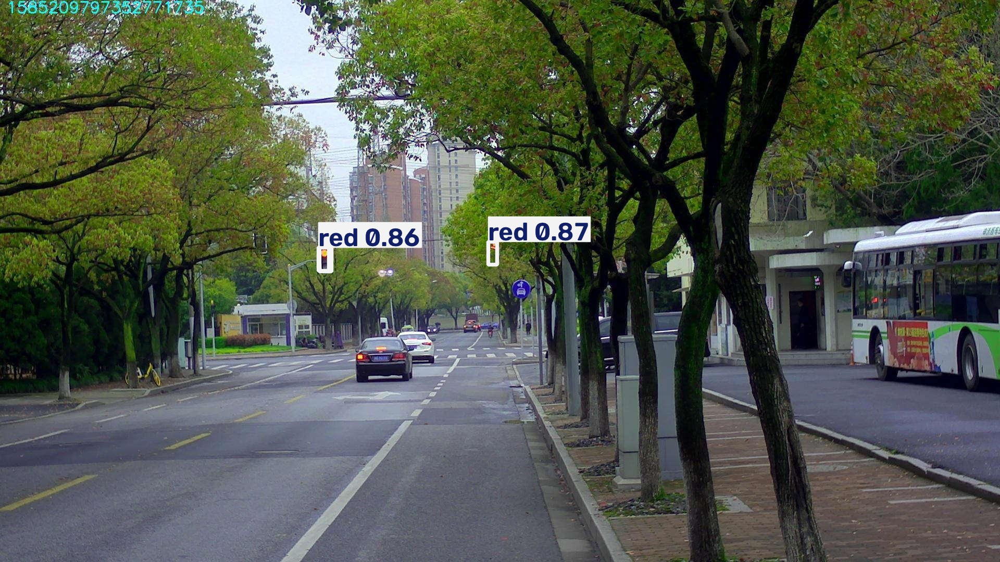 | 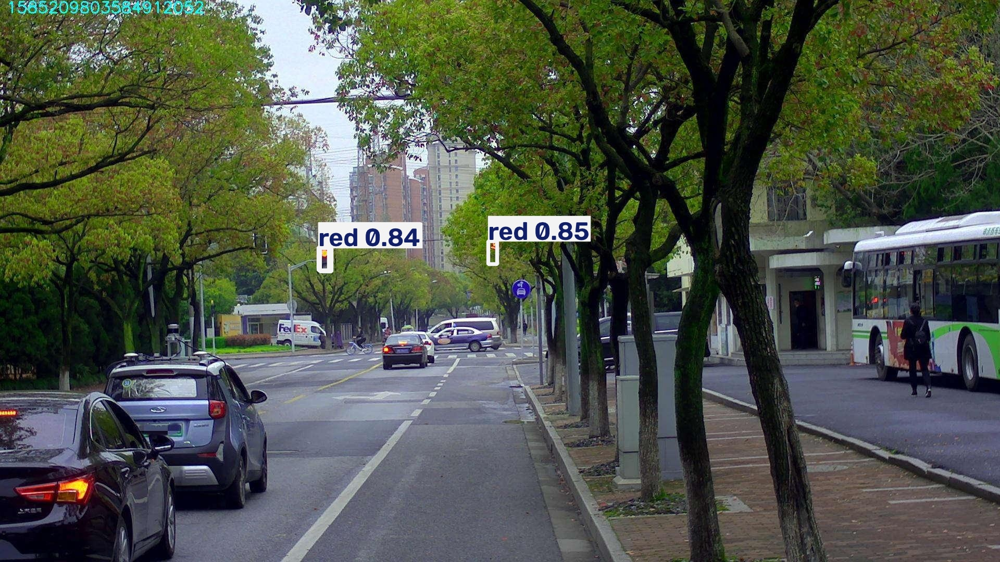 |
| 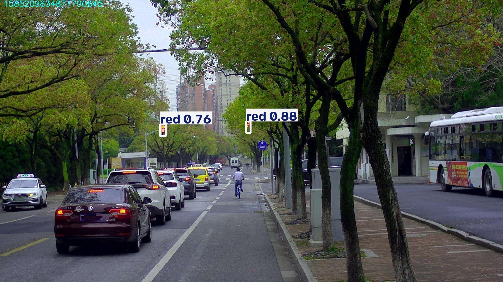 | 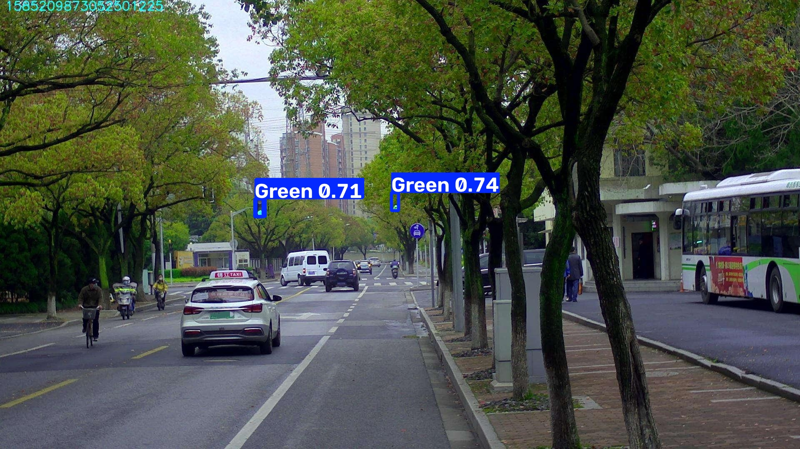 |

---

## 6. Inferencia en Video en Tiempo Real (`45.9 FPS`)

El modelo entrenado (`best.pt`) fue evaluado cuadro a cuadro sobre la secuencia de conducción urbana (`data/inference_traffic_light_video.mp4`), procesando **454 fotogramas a 45.9 FPS continuos en GPU**:

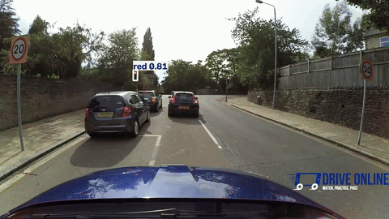

- **Archivo de video completo codificado en H.264 (1280×720, 25 FPS):** [`assets/inference_output.mp4`](assets/inference_output.mp4)

---

---

## 7. Licencia

Distribuido bajo la licencia **MIT**. Consulte el archivo [`LICENSE`](LICENSE) para más información.
